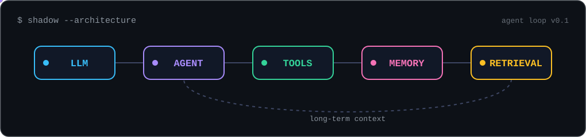

<picture>
  <source media="(prefers-color-scheme: dark)" srcset="assets/header.svg">
  <source media="(prefers-color-scheme: light)" srcset="assets/header-light.svg">
  
</picture>

 

<picture>
  <source media="(prefers-color-scheme: dark)" srcset="assets/terminal.svg">
  <source media="(prefers-color-scheme: light)" srcset="assets/terminal-light.svg">
  
</picture>

## ⟡ About

Developer building things from the ground up — from **AI assistants and memory systems** to **developer infrastructure, CI/CD platforms, and full-stack products**. Focused on software that's useful beyond a demo: systems that run locally, automate real workflows, and evolve over time.

- 🕶️ Building **SHADOW** — a local-first AI assistant with persistent memory, tool execution, and an evolving agent architecture
- 🧬 Working toward **Project Epsilion** — a long-term memory and storage layer for AI systems
- ⚡ Building **Drev CI** — a lightweight self-hosted CI runner built around Docker and developer workflows
- 🌌 Building **Obliquity** — a space-inspired software brand and product ecosystem
- 🌱 Getting serious about **Open Source** — actively looking for projects to contribute to
- 🦀 Exploring **systems programming** alongside the web stack

> I like understanding how things work underneath the abstraction — then building my own version.

## ⟡ The Agent Loop

The architecture behind SHADOW — every packet you see traveling is context moving through the system:

<picture>
  <source media="(prefers-color-scheme: dark)" srcset="assets/architecture.svg">
  <source media="(prefers-color-scheme: light)" srcset="assets/architecture-light.svg">
  
</picture>

## ⟡ Projects

<b>🕶️ SHADOW</b> — local-first AI assistant with persistent memory

 

An AI assistant designed to work across environments while maintaining persistent conversation memory and local capabilities.

**Architecture**

`LLM → Agent → Tools → Memory → Retrieval → Long-term Context`

- Persistent memory that survives sessions
- Tool execution: shell, files, web, vision
- Modular provider/tool architecture — swap models without touching the core

**Stack:** `Python` `Ollama` `SQLite`

<b>🧬 Project Epsilion</b> — long-term AI memory & storage infrastructure

 

The long-term vision behind SHADOW's memory layer. A private, self-hosted memory and storage system designed to eventually give AI systems their own persistent knowledge space.

**Goal:** make AI memory something you actually control.

**Stack:** `AI Systems` `Storage` `Infrastructure`

<b>⚡ Drev CI</b> — lightweight self-hosted CI runner

 

A CI runner focused on simplicity and developer control — no vendor lock-in, no black boxes.

**Pipeline**

`Webhook → Runner → Docker → Real-time Logs`

- Docker-based execution & YAML pipelines
- GitHub webhook triggers
- Server/runner architecture with a Next.js dashboard

**Stack:** `Go` `Docker` `Next.js` `SQLite`

<b>🌌 Obliquity</b> — space-inspired software ecosystem

 

A software brand and experimental ecosystem focused on building polished, modern developer products — built around a space-inspired identity with equal weight on **engineering + design**.

**Stack:** `Next.js` `TypeScript`

<b>📊 More builds</b> — dashboards, tools & experiments

 

| Project | What it is | Stack |
|---|---|---|
| **Automated CI/CD Dashboard** | Real-time deployment & pipeline monitoring | Jenkins, Docker, Node.js, Socket.IO |
| **Task Manager** | Full-stack task management platform | Next.js, Firebase |

## ⟡ Stack

**Languages**

**Frontend**

**Backend & Data**

**DevOps & AI**

## ⟡ Signals

<picture>
  <source media="(prefers-color-scheme: dark)" srcset="https://raw.githubusercontent.com/KoushikSagarr/KoushikSagarr/output/github-contribution-grid-snake-dark.svg">
  <source media="(prefers-color-scheme: light)" srcset="https://raw.githubusercontent.com/KoushikSagarr/KoushikSagarr/output/github-contribution-grid-snake.svg">
  
</picture>

## ⟡ Open Source

Getting serious about open source — looking for projects where I can contribute, learn from experienced maintainers, and eventually maintain systems rather than just consume them.

`AI` · `Developer Tools` · `DevOps` · `Infrastructure` · `Python` · `Go` · `TypeScript`

*"Build things worth remembering."*

<picture>
  <source media="(prefers-color-scheme: dark)" srcset="assets/footer.svg">
  <source media="(prefers-color-scheme: light)" srcset="assets/footer-light.svg">
  
</picture>

